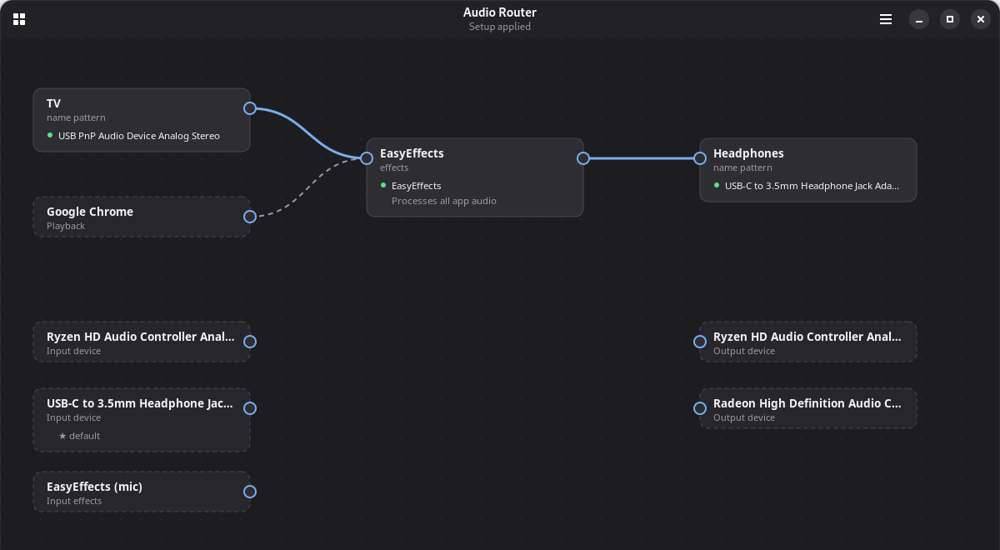

# Audio Router

A small GNOME app that shows your PipeWire audio setup as a graph and lets you rewire it: drag
from one box to another to connect an input, EasyEffects or an output. The setup is saved,
re-applied at login and kept applied when devices are unplugged, renamed or replaced.

> [!WARNING]
> **This project is vibe coded** — I wrote it largely with an AI coding assistant.
>
> I only use it on Fedora with GNOME; other distributions and desktops are untested — **use it at
> your own risk**.



## Features

- Live view of the real links between devices, apps, loopbacks and EasyEffects.
- Connect any input (e.g. a TV on a capture device) to an output; it plays through a loopback
  named after the box, so it shows up with that name in the sound settings.
- Devices are matched by model, exact device, vendor or name pattern, so a renamed or replaced
  device keeps working.
- Groups: audio sent to a group goes to every device in it.
- Starts EasyEffects when the setup needs it; problems show as a red banner.
- Runs in the background with an optional tray icon, and can start at login.

## Requirements

PipeWire with WirePlumber and pipewire-pulse (`pactl`), GTK 4.14+ and libadwaita 1.6+.
EasyEffects is optional.

## Download

Releases have a prebuilt x86_64 binary (`audiorouter-X.Y-x86_64-linux.tar.gz`, built on Fedora 43;
needs a similarly recent distribution). Unpack it and run `audiorouter`.

## Build

Needs a Rust toolchain ([rustup](https://rustup.rs)) and the development packages:

```sh
# Fedora
sudo dnf install gtk4-devel libadwaita-devel pipewire-devel clang-devel
# Debian / Ubuntu
sudo apt install libgtk-4-dev libadwaita-1-dev libpipewire-0.3-dev libclang-dev

cargo build --release   # target/release/audiorouter
./install.sh            # copies it to ~/Applications/AudioRouter/ (no desktop entry)
```

Run `audiorouter` to open the window; enable **Start at Login** in the menu to apply the setup
automatically. The setup is stored in `~/.config/audiorouter/`.
